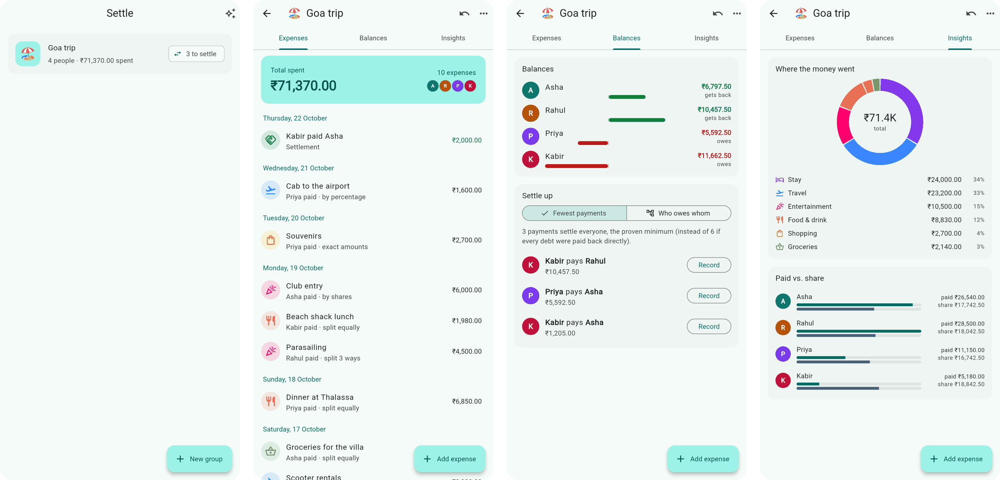

<p align="center"></p>

# Settle

[](https://github.com/pMag11-alt/settle/actions/workflows/ci.yml)
[](https://pmag11-alt.github.io/settle/?demo=balances)


**Split group expenses and settle up in the fewest possible payments.** Settle
is a Flutter app for Android, iOS and the web, for trips, flatmates and
dinners. Add who paid for what and how it should be split. Settle keeps
everyone's balance and works out the smallest set of payments that makes the
whole group square. The plan is not just a good guess: it is proven minimal.

**[▶ Try it in your browser](https://pmag11-alt.github.io/settle/?demo=balances)**: the link
opens with a sample Goa trip. Data stays in your browser.



## Features

- **Groups** for any occasion, each with its own currency: ₹, $, €, £, ¥ and more.
- **Four ways to split** an expense:
  - equally among some or all of the group
  - exact amounts
  - percentages
  - shares (say, 2 : 1 : 1)

  The editor checks the split as you type ("₹200.00 left to assign").
- **Balances** at a glance, and **a settle-up plan** with the fewest payments.
  Record a payment from the plan with one tap.
- **Insights**: spending by category, what each person paid versus their share,
  and monthly totals.
- **Undo** for every change, and an **activity feed** of everything that
  happened in the group.
- **Export**: a CSV of every expense with each person's share, or a text
  summary to paste into the group chat.
- Light and dark themes, a layout that fits a 360 dp phone, and offline-first
  storage on every platform.

## Fewest payments, provably

Suppose the trip ends with these balances (in ₹ thousands):

| Asha | Rahul | Priya | Kabir | Zoya |
|---|---|---|---|---|
| +3 | +2 | +2 | −3 | −4 |

The usual approach is the greedy one: the biggest debtor pays the biggest
creditor, repeatedly. Here that takes **4 payments**:

1. Zoya → Asha 3
2. Kabir → Rahul 2
3. Kabir → Priya 1
4. Zoya → Priya 1

But Asha and Kabir cancel out exactly. Kabir → Asha 3 settles them, and
Zoya → Rahul 2 plus Zoya → Priya 2 settles the rest: **3 payments**.

The general rule is this. Any set of people whose balances sum to zero can
settle among themselves in (size − 1) payments, and not in fewer. So the
minimum number of payments is *k* − *p*, where:

- *k* is the number of people who are not already square.
- *p* is the largest number of disjoint zero-sum groups they can be split into.

Finding *p* is NP-hard in general (it contains subset-sum). Groups that split
bills are small, though, so [`settleOptimal`](lib/domain/settle.dart) solves it
**exactly** with a dynamic program over subsets:

```
best[S] = max over i in S of best[S \ {i}] + (1 if sum(S) = 0 else 0)
```

Taking people out one at a time and counting how often the remaining set sums
to zero counts the zero-sum blocks of a partition. Walking the choices back
recovers the blocks, and each block is settled greedily within itself.

- **Cost:** O(2ᵏ · k) time. Up to 18 people with open balances that is a few
  milliseconds; above that, Settle falls back to the greedy plan.
- **Verification:** the tests check the plan on 400 random groups against a
  brute-force search over every set partition, and confirm it always settles
  everyone. The example above is a test too.

## Money is never a double

Every amount is an integer number of minor units (paise, cents). Input is
parsed digit by digit, so "0.1 + 0.2" can never become 0.30000000000000004.

Splitting ₹1,000 three ways must give 333.34 + 333.33 + 333.33, not three
copies of 333.33. Settle uses the **largest-remainder method**. Everyone gets
the floor of their exact share, then the leftover paise go to the largest
fractional parts, with ties going to whoever is listed first. The parts always
add up to the total exactly, and none is ever a whole paisa away from its exact
value. Products go through `BigInt`, so even absurd amounts stay exact. 5,000
random allocations are checked in the tests.

## Architecture

```
lib/
  domain/      pure Dart, no Flutter: easy to test
    money.dart     Currency, parsing and formatting, largest-remainder allocate()
    model.dart     Member, Expense, Split (equal/exact/percent/shares), Payment, Group
    events.dart    the event log: GroupCreated, ExpenseAdded, PaymentRecorded, …
    settle.dart    balances, greedy and optimal settle-up plans, pairwise debts
    insights.dart  spending by category, member and month; CSV export
  data/store.dart  persistence: SharedPreferences (localStorage on the web)
  state/           AppState (a ChangeNotifier) and the sample trip
  ui/              screens and widgets, Material 3
```

**Event sourcing.** A group is not stored as its current state but as an
append-only log of events (`ExpenseAdded`, `PaymentRecorded`, `ExpenseDeleted`,
…). Its state is a fold over that log. That gives three things almost for
free:

- **Undo:** drop the last event and replay.
- **The activity feed:** render the log.
- **Robust storage:** an old log replays with new code.

State management is a single `ChangeNotifier` exposed through an
`InheritedNotifier`, with no third-party framework. The only dependencies are
`shared_preferences` and `intl`.

## Tests

`flutter test` runs 30 tests:

- **Domain:** money parsing and formatting, and largest-remainder allocation
  (5,000 random cases). Every split mode, including its validation. Balances,
  and the settle-up plans against brute force. The event log round-tripping
  through JSON, and undo.
- **Widgets:** the full flows of trying the sample trip, creating a group,
  adding an expense, and rejecting a split that doesn't add up. Also recording
  a suggested payment, swipe-to-delete and undo, and data surviving a restart.
- **Layout:** every screen and split mode at 360 dp wide, in light and dark
  mode. Flutter fails the test on any overflow. This caught a real bug: a
  currency dropdown 35 px too wide for small phones.

CI checks `dart format` and `flutter analyze`, runs the tests, and builds the
web app (deployed to GitHub Pages), a release APK (attached to each run) and
an unsigned iOS build.

## Running it

You need Flutter 3.41 or newer.

```sh
flutter pub get
flutter run                 # on a connected phone, a simulator or an emulator
flutter run -d chrome       # in the browser
flutter test
flutter build apk           # build/app/outputs/flutter-apk/app-release.apk
```

On the web, `?demo=expenses`, `?demo=balances` or `?demo=insights` loads the
sample trip into an empty browser and opens it on that tab.

## License

[MIT](LICENSE) © 2026 Parshwa Magdum
